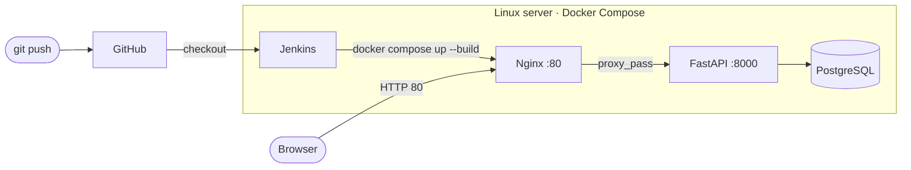

# jenkins-pet

A small FastAPI app deployed by a Jenkins pipeline with Docker Compose.
I built it to learn how a CI/CD server pulls code from GitHub and rolls out containers
on a Linux host.

The app shows one page with the status of its PostgreSQL connection, which makes it easy
to see after a deploy whether the whole stack came up.

## Stack

| Part | Technology |
| --- | --- |
| App | Python, FastAPI, Jinja2 |
| Database | PostgreSQL 15 |
| Reverse proxy | Nginx |
| Containers | Docker, Docker Compose |
| CI/CD | Jenkins (declarative pipeline) |

## Architecture



Only Nginx publishes a port. FastAPI and PostgreSQL are reachable only inside the
Compose network.

## Pipeline

The [Jenkinsfile](Jenkinsfile) runs four stages:

1. **Checkout**: pulls the repository from GitHub
2. **Docker Down**: stops the running containers
3. **Docker Deploy**: rebuilds the images and starts the stack
4. **Cleanup**: removes dangling images so the disk does not fill up

## Run locally

Requirements: Docker with Compose v2.

```bash
cp .env.example .env    # set POSTGRES_PASSWORD and the same password in DATABASE_URL
docker compose up --build
```

Open <http://localhost>. The page should say the database is connected.

## What I would add next

- [ ] A test stage before deploy, so a broken build never reaches the server
- [ ] Health check after deploy
- [ ] Named volume for PostgreSQL data
